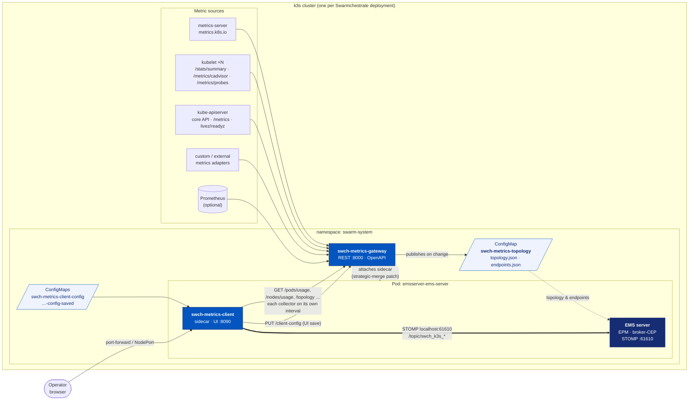
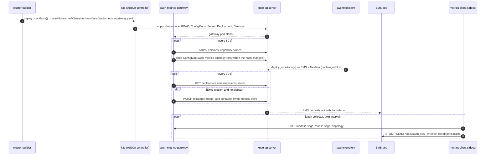
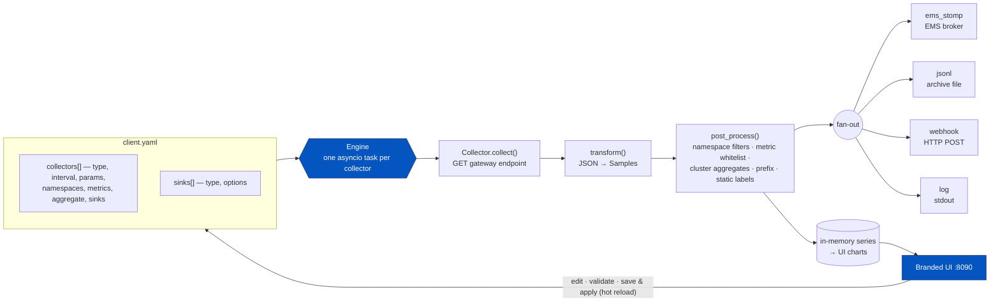
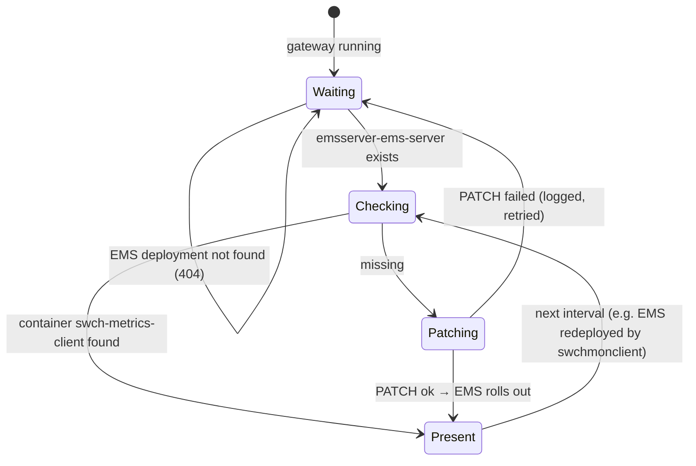
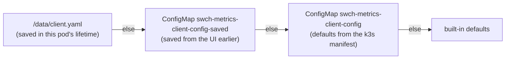
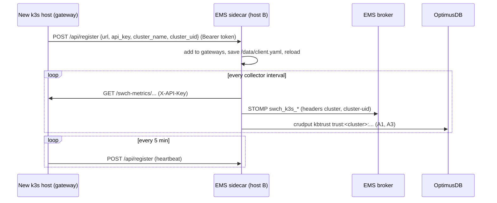

<p align="center">
  
  &nbsp;&nbsp;&nbsp;
  <picture>
    <source media="(prefers-color-scheme: dark)" srcset="docs/assets/imu-white.png">
    
  </picture>
  &nbsp;&nbsp;
  <picture>
    <source media="(prefers-color-scheme: dark)" srcset="docs/assets/iccs-white.png">
    
  </picture>
</p>

<h1 align="center">k3s Metrics Gateway &amp; EMS Metrics Client</h1>

<p align="center">
  Per-cluster metrics &amp; topology API for every Swarmchestrate-orchestrated k3s cluster,<br>
  plus a modular, UI-configurable metrics client that runs as a sidecar of EMS.
</p>

<p align="center">
  <a href="https://georgegeorgakakos.github.io/k3s-metrics-gateway/demo/"></a>
  <a href="../../actions/workflows/ci.yml"></a>
  <a href="LICENSE"></a>
  
  
</p>

---

## Overview

When Swarmchestrate deploys a k3s cluster, this repository adds three pieces to it:

| Component | Runs as | Purpose |
|---|---|---|
| **Metrics Gateway** (`swch-gateway`) | `Deployment swch-metrics-gateway` in `swarm-system` | One REST API over all of the cluster's metrics sources: metrics-server, kubelet summary, cAdvisor, probes, core API, API server, custom/external metrics and optional Prometheus. |
| **Topology publisher** (inside the gateway) | ConfigMap `swch-metrics-topology` | Tells EMS what the cluster looks like (swarm/cluster ID, nodes, zones, clouds, capacity) and where each metric can be fetched (endpoint catalog with availability). |
| **Metrics Client** (`swch-metrics-client`) | **Sidecar container in the EMS pod** (`emsserver-ems-server`) | Modular collectors, each polling on its own interval. They publish to the EMS broker over STOMP (`localhost:61610`) and can be configured from a Swarmchestrate-branded web UI. |

The gateway is shipped as a **k3s auto-deploy manifest**, so it fits the existing
[`cluster-builder`](https://github.com/Swarmchestrate/cluster-builder) flow. `deploy_manifests()` copies it to
`/var/lib/rancher/k3s/server/manifests/` and k3s applies it on its own.
EMS is still deployed by [`swchmonclient`](https://github.com/Swarmchestrate/monitoring-client) as before.
The gateway detects the EMS Deployment and attaches the sidecar automatically.

**👉 [Try the UI with simulated data](https://georgegeorgakakos.github.io/k3s-metrics-gateway/demo/)** (runs entirely in the browser)

---

## Architecture



### What happens on deployment



### Inside the client



### Sidecar attachment lifecycle



> GitHub renders these diagrams natively. Use the controls on each figure to zoom, pan or view it full screen.
> The same figures are also on the [project page](https://georgegeorgakakos.github.io/k3s-metrics-gateway/).

---

## Quick start

### 1. Deploy the gateway with the cluster

**With cluster-builder (recommended).** Render a manifest for the swarm and put it in the folder you pass to `deploy_manifests()`:

```bash
python scripts/render_manifest.py \
  --swarm-id swarm-42 --cluster-name swch-demo --cloud aws --region eu-west-1 \
  --api-key auto --ui-password auto \
  -o manifests/swch-metrics-gateway.yaml
```

See [`deploy/examples/cluster_builder_deploy.py`](deploy/examples/cluster_builder_deploy.py).

**On an existing cluster, straight from the latest release:**

```bash
kubectl apply -f https://github.com/georgeGeorgakakos/k3s-metrics-gateway/releases/latest/download/swch-metrics-gateway.yaml
```

**Or from a clone:**

```bash
kubectl apply -f deploy/k3s/swch-metrics-gateway.yaml
# or on the k3s server node:
sudo cp deploy/k3s/swch-metrics-gateway.yaml /var/lib/rancher/k3s/server/manifests/
```

**Check the gateway:**

```bash
kubectl -n swarm-system get pods                                   # swch-metrics-gateway-… Running
kubectl -n swarm-system get cm swch-metrics-topology -o yaml       # topology published for EMS
kubectl -n swarm-system port-forward svc/swch-metrics-gateway 8000:8000
# → http://localhost:8000/docs   (try /pods/usage, /nodes/usage, /topology)
```

### 2. Deploy EMS as usual

`swchmonclient.deploy_monitoring(...)` deploys EMS. Within about 30 s the gateway patches the sidecar into
`emsserver-ems-server`. Check it with:

```bash
kubectl -n swarm-system get deploy emsserver-ems-server -o jsonpath='{.spec.template.spec.containers[*].name}'
# ems-server swch-metrics-client
curl -s http://localhost:8000/status  # (port-forwarded) shows the attacher result
```

If you prefer not to let the gateway patch EMS, render with `--no-attach-sidecar` and apply
[`deploy/ems/ems-sidecar-patch.yaml`](deploy/ems/ems-sidecar-patch.yaml) yourself. Alternatively, run the client standalone with
[`deploy/examples/client-standalone.yaml`](deploy/examples/client-standalone.yaml).

### 3. Open the UI

```bash
kubectl -n swarm-system port-forward svc/swch-metrics-client-ui 8090:8090
# → http://localhost:8090   (user: admin, password: UI_PASSWORD from Secret swch-metrics-gateway-auth)
```

To reach the UI from outside the cluster, render with `--expose-ui nodeport`; it is then on port `30890` of every node.

### 4. Confirm EMS receives the metrics

```bash
kubectl -n swarm-system port-forward svc/emsserver-ems-server 61610:61610
python EMSClient.py --host localhost --port 61610 --topic "/topic/swch_k3s_>"   # from Swarmchestrate/EMSTopicConsumer
```

Messages such as `swch_k3s_node_cpu_pct` and `swch_k3s_pod_cpu_millicores` should arrive at each collector's interval.
If the EMS metric model expects `*_SENSOR` topics, open the UI → **Sinks** → `ems` and set the destination to `/topic/{metric}_SENSOR`.

---

### Gateway and EMS on different hosts

When the workloads (e.g. OptimusDB) run in one k3s cluster and EMS runs in another, render one manifest per host.
Since v0.3 the gateway can also register itself with the EMS sidecar (`--register-url`, `--register-token`), so
host B needs no `--gateway-url`. See [Many clusters and automatic registration](#many-clusters-and-automatic-registration).
The sidecar still runs inside the EMS pod and calls the gateway over the network.
On locked-down VMs, use the k3s Traefik ingress on port 80 (`--expose-gateway ingress`) so no extra ports are needed.

```bash
# Host A: k3s cluster with the workloads; gateway at http://<HOST_A>/swch-metrics
python scripts/render_manifest.py --role gateway --swarm-id swarm-01 --expose-gateway ingress \
  --gateway-url http://<HOST_A>/swch-metrics --api-key <KEY> -o hostA-gateway.yaml

# Host B: EMS; sidecar resources plus the patch, and the UI at http://<HOST_B>/swch-metrics-ui/
python scripts/render_manifest.py --role ems --namespace <EMS_NAMESPACE> --swarm-id swarm-01 \
  --gateway-url http://<HOST_A>/swch-metrics --api-key <KEY> --ui-password auto --expose-ui ingress \
  -o hostB-ems.yaml --patch-output hostB-ems-sidecar-patch.yaml
```

```bash
# on host A
sudo cp hostA-gateway.yaml /var/lib/rancher/k3s/server/manifests/

# on host B
curl -H "X-API-Key: <KEY>" http://<HOST_A>/swch-metrics/health      # B must reach A on port 80
kubectl apply -f hostB-ems.yaml
kubectl -n <EMS_NAMESPACE> patch deployment emsserver-ems-server --patch-file hostB-ems-sidecar-patch.yaml
```

Use the same `<KEY>` on both hosts. Alternatives:
- **`--expose-gateway nodeport`:** the gateway listens on port 30800 instead of going through the ingress.
- **`--ingress-allow-ip <cidr>`:** limits the routes by source IP. Only use it if Traefik sees real client IPs.

With `--role ems`, the configuration saved from the UI is kept on a local PVC in host B's cluster.
EMS receives host A's topology on the `swch_k3s_topology` topic.

### EMS reachable only through an SSH tunnel (locked-down hosts)

A common Swarmchestrate setup has OptimusDB and EMS on separate VMs, with the EMS VM exposing only SSH.
OptimusDB then reaches the EMS broker through an `autossh` tunnel on its own VM, which listens on `0.0.0.0:61610`.
In that case, run everything on the workload host and publish through the same tunnel. No ports are opened, and the EMS host is not changed.

```bash
python scripts/render_manifest.py --role standalone --swarm-id swarm-01 --cluster-name epm-server \
  --api-key auto --ui-password auto -o swch-metrics-gateway.yaml
sudo cp swch-metrics-gateway.yaml /var/lib/rancher/k3s/server/manifests/      # on the workload host
```

The client runs as its own Deployment (`swch-metrics-client`) and connects to `status.hostIP:61610`, which is the tunnel.
Use `--ems-broker-host <ip>` if the broker is reachable some other way.

## What EMS gets

### Topology (`ConfigMap swch-metrics-topology`, also `GET /topology`)

| Key | Content |
|---|---|
| `GATEWAY_URL` | In-cluster URL of the gateway (`http://swch-metrics-gateway.swarm-system.svc.cluster.local:8000`) |
| `CLUSTER_ID` / `SWARM_ID` | Stable cluster ID (UID of `kube-system`) and the swarm ID from `swch-cluster-identity` |
| `topology.json` | The full document: identity, k3s version, API server, nodes (roles, IPs, zone/region/cloud, capacity, readiness, per-node metric URLs) and summary |
| `endpoints.json` | The metric endpoint catalog: `id`, `path`, `url`, `source`, `available` |

The `swch-metrics-gateway` Service also carries discovery annotations: `swarmchestrate.eu/metrics-api: "true"`,
`swarmchestrate.eu/topology-configmap`, and `swarmchestrate.eu/openapi`.

### Metrics (STOMP, from the sidecar)

Each sample becomes one STOMP message to `destination` (default `/topic/{metric}`). The format follows the existing
Swarmchestrate monitoring conventions (see [EMSTopicConsumer](https://github.com/Swarmchestrate/EMSTopicConsumer)):

```text
destination:      /topic/swch_k3s_node_cpu_pct
metric:           swch_k3s_node_cpu_pct
instance:         swch-worker-edge
timestamp:        1794609789985
node-id:          <stable client UUID>
producer-host:    10.42.0.17
source-node:      swch-worker-edge
source-endpoint:  http://swch-metrics-gateway.swarm-system.svc.cluster.local:8000/nodes/usage
cloud / region / zone / swarm-id, label-<name>: …

{"metricValue": 48.1, "level": 1, "timestamp": 1794609789985}
```

`body_format: json` sends the whole sample instead, and `headers_only` sends an empty body.
The topology document is published once per change on `/topic/swch_k3s_topology`.
To match a TOSCA metric model that expects `*_SENSOR` topics, set `destination: /topic/{metric}_SENSOR`.

---

## Configuration

Configuration lives in `client.yaml`. You can edit it in the UI (with forms or the YAML editor) or by changing the ConfigMap.
Each collector, sink and the gateway can be configured separately, and every string accepts `${ENV}` and `${ENV:-default}` placeholders.
Placeholders are kept unexpanded when the config is saved, so secrets never end up in a ConfigMap.



The UI never writes to the defaults ConfigMap. k3s re-applies the auto-deploy manifest whenever it changes or k3s restarts, so a saved configuration has to live elsewhere to survive.

### Collector types

| Type | Gateway endpoint | Emits (before prefix) |
|---|---|---|
| `node_usage` | `/nodes/usage` | `node_cpu_millicores`, `node_cpu_pct`, `node_memory_mib`, `node_memory_pct` |
| `pod_usage` | `/pods/usage` | `pod_cpu_millicores`, `pod_memory_mib` (+ per container) |
| `pod_overview` | `/pods/overview` | `pod_cpu_pct_of_request/limit`, `pod_memory_pct_of_request/limit`, `pod_restarts`, `pod_running` |
| `pod_stats` | `/pods/stats` | `pod_network_{rx,tx}_bytes_per_sec`, `pod_memory_working_set_mib`, `pod_ephemeral_storage_used_mib`, `pod_volume_used_{mib,pct}` |
| `events` | `/events` | `k8s_event` (only new events; labels: `reason`, `kind`, `object`) |
| `cadvisor` | `/cadvisor` | any cAdvisor metric; counters are converted to `*_per_sec` |
| `topology` | `/topology` | `cluster_nodes_total/ready`, `node_ready`, plus the full document when it changes |
| `apiserver_health` | `/apiserver/health` | `apiserver_livez`, `apiserver_readyz` |
| `prometheus` | `/prometheus/query` | the result of any PromQL query |
| `http_json` | any path | values mapped from JSON fields (`items_path`, `value_field`, `label_fields`) |

Options shared by every collector: `interval`, `enabled`, `sinks` (subset), `gateways` (subset of clusters;
default all), `include_namespaces`, `exclude_namespaces`, `metrics` (whitelist), `aggregate`
(`sum|avg|min|max|count` → `<metric>_<op>` with `instance=cluster`, per cluster) and `metric_prefix`.

### Gateways (clusters)

`gateways:` lists one entry per k3s cluster: `id`, `url`, `api_key`, `cluster` (name used in EMS and OptimusDB;
default from the gateway's topology), `swarm_id`, `labels`, `enabled`. Entries are added by hand, in the UI
(**Gateways** tab), or by the gateways themselves through `POST /api/register` when `registration.token`
(env `REGISTRATION_TOKEN`) is set. See [docs/multi-cluster.md](docs/multi-cluster.md).

### Sink types

| Type | What it does |
|---|---|
| `ems_stomp` | Publishes to the EMS broker (`localhost:61610` when running as a sidecar). Reconnects with backoff. |
| `jsonl` | Appends to a JSON-lines file, with size-based rotation |
| `webhook` | POSTs each batch as JSON (e.g. to OptimusDB or another ingest endpoint) |
| `log` | Writes samples to the container log |
| `optimusdb_trust` | Derives trust attributes **A1 Availability** and **A3 Operational stability** per pod, node and control plane and upserts them into OptimusDB (`kbtrust`). See [docs/trust-optimusdb.md](docs/trust-optimusdb.md) |

The full annotated example is [`deploy/examples/client.full.yaml`](deploy/examples/client.full.yaml).

### Writing your own collector

```python
# my_org/swch_plugins.py — add "my_org.swch_plugins" to `plugins:` in client.yaml
from swch_metrics.client.collectors import Collector, register, param
from swch_metrics.client.model import Sample

@register
class PendingPods(Collector):
    type = "pending_pods"
    title = "Pending pods"
    description = "Number of Pending pods per namespace."
    endpoint = "/pods/status"
    params_schema = {"namespace": param("string", None, "Namespace (empty = all)")}
    outputs = ["pods_pending"]

    def query(self):
        return {"namespace": self.params.get("namespace")}

    def transform(self, pods):
        counts = {}
        for p in pods:
            if p["phase"] == "Pending":
                counts[p["namespace"]] = counts.get(p["namespace"], 0) + 1
        return [Sample(metric="pods_pending", value=n, labels={"namespace": ns}, instance=ns)
                for ns, n in counts.items()]
```

The UI builds its forms from `params_schema`, so a new collector appears there with a working form automatically.

---

## Gateway API

Interactive OpenAPI docs are served at `/docs`. All endpoints except `/health` need `X-API-Key` when `API_KEY` is set.

| Area | Endpoints |
|---|---|
| metrics.k8s.io | `/pods/usage`, `/pods/{ns}/{pod}/usage`, `/nodes/usage` |
| kubelet | `/pods/stats`, `/nodes/{node}/summary`, `/nodes/{node}/cadvisor`, `/cadvisor`, `/nodes/{node}/resource`, `/nodes/{node}/probes`, `/nodes/{node}/kubelet` |
| core | `/pods/status`, `/pods/overview`, `/events`, `/nodes` |
| apiserver | `/apiserver/metrics`, `/apiserver/health` |
| adapters | `/custom-metrics/{path}`, `/external-metrics/{path}` |
| prometheus | `/prometheus/query`, `/prometheus/query_range`, `/prometheus/targets`, `/prometheus/pods/{preset}` |
| topology | `/topology`, `/endpoints`, `/capabilities`, `/status` |
| registration | `GET /registration` (status of the self-registration with EMS), `POST /registration` (register now) |
| sidecar | `GET/PUT /client-config/{namespace}` |
| raw | `/raw?path=/api/...` (read-only) |

### Permissions (RBAC)

The gateway only reads metrics. It can write three things:

- **Topology:** the `swch-metrics-topology` ConfigMap.
- **Saved client config:** the `swch-metrics-client-config-saved` ConfigMap.
- **Sidecar patch:** `get` and `patch` on the EMS Deployment only (`resourceNames: [emsserver-ems-server]`).

Both containers run as non-root (UID 10001) with a read-only root filesystem and all capabilities dropped.

---

## Development

```bash
make install         # pip install -e ".[dev]"
make test            # unit tests: gateway, topology, attacher, collectors, sinks, engine, UI API
make manifest        # regenerate deploy/k3s and deploy/ems from scripts/render_manifest.py
make run-gateway     # gateway against your k3s (KUBECONFIG=/etc/rancher/k3s/k3s.yaml)
make run-client      # client + UI on http://localhost:8090 using deploy/examples/client.local.yaml
make image           # one image, two entrypoints: swch-gateway / swch-metrics-client
make site            # GitHub Pages site (_site/) with the in-browser demo
```

Repository layout:

```text
src/swch_metrics/gateway/   FastAPI gateway, topology publisher, EMS sidecar attacher
src/swch_metrics/client/    engine, collectors/, sinks/, config, UI server, ui/ (static, no CDN needed)
deploy/k3s/                 k3s auto-deploy manifest (generated)
deploy/ems/                 manual sidecar patch (generated)
deploy/examples/            client configs, standalone client, cluster-builder example
scripts/                    render_manifest.py, build_demo_data.py, build_site.py
```

### Releases

Pushing a tag `vX.Y.Z` that matches `pyproject.toml` triggers [`release.yml`](.github/workflows/release.yml). It:

1. Builds a multi-arch image (`linux/amd64`, `linux/arm64` for edge nodes) and pushes it to GHCR.
2. Renders the manifests with that image tag.
3. Attaches `swch-metrics-gateway.yaml` and `ems-sidecar-patch.yaml` to the GitHub release.

The image name comes from the repository owner, so the workflow works under the org or a personal fork.

### One-time repository setup

1. **Pages:** in **Settings → Pages**, set **Source** to **GitHub Actions**. The project page and the
   [live demo](https://georgegeorgakakos.github.io/k3s-metrics-gateway/demo/) are published on every push to `main`.
2. **Package visibility:** after the first release, open **Packages → k3s-metrics-gateway → Package settings** and make it **Public**,
   so k3s nodes can pull `ghcr.io/georgegeorgakakos/k3s-metrics-gateway` without credentials.

---

## Many clusters and automatic registration

One EMS sidecar polls any number of k3s clusters. A gateway deployed on a new k3s host registers itself with the
sidecar, and EMS receives that cluster's metrics, labelled with its `cluster`, without any step on the EMS host:

```bash
# on the new k3s host
curl -fsSL https://raw.githubusercontent.com/georgeGeorgakakos/k3s-metrics-gateway/v0.3.1/deploy/onboard/onboard-k3s-host.sh -o onboard-k3s-host.sh
sudo REGISTER_URL=http://<ems-host>/swch-metrics-ui/api/register REGISTER_TOKEN=<token> \
     CLUSTER_NAME=edge-07 SWARM_ID=swarm-01 bash onboard-k3s-host.sh
```



**Zero-touch:** `bash make-autoregister-manifest.sh` on the EMS host builds one file; dropped into
`/var/lib/rancher/k3s/server/manifests/` of any new k3s host (VM image, cloud-init, cluster-builder) it makes that
host register itself, named after its node, with no command on the host.

Step-by-step guide with diagrams and the end-to-end test (UI → EMS → OptimusDB, `deploy/onboard/e2e-check.sh`):
[docs/add-k3s-host.md](docs/add-k3s-host.md). Design and configuration: [docs/multi-cluster.md](docs/multi-cluster.md).

## Documentation

| Document | Content |
|---|---|
| [deploy/onboard/](deploy/onboard/) · [deploy/hosts/](deploy/hosts/) | Scripts for new k3s hosts (zero-touch manifest, one-command onboarding, end-to-end check) and for the existing hosts A and B |
| [docs/add-k3s-host.md](docs/add-k3s-host.md) | **Step by step: add a new k3s host** (commands per host, diagrams) and the end-to-end test from the sidecar UI to the OptimusDB records |
| [docs/multi-cluster.md](docs/multi-cluster.md) | One EMS sidecar for many k3s clusters; automatic gateway registration and onboarding of new hosts |
| [docs/trust-optimusdb.md](docs/trust-optimusdb.md) | Trust evidence (A1 Availability, A3 Operational stability) persisted in OptimusDB `kbtrust` |
| [docs/query-kbtrust.md](docs/query-kbtrust.md) | Reading the trust records back from OptimusDB `kbtrust`: filters, `curl` queries, `kbtrust-query.sh` |
| [docs/archimate/](docs/archimate/) | ArchiMate 3.1 model (Open Exchange XML for Archi) and the two views as SVG / PNG |
| [docs/Swarmchestrate_k3s-Metrics-Gateway_E2E-Guide_ICCS_14112026.pptx](docs/Swarmchestrate_k3s-Metrics-Gateway_E2E-Guide_ICCS_14112026.pptx) | End-to-end guide: flow, new deployment, metric list, test commands, UI guide |

> Per-host deployment files rendered with `--api-key auto` / `--ui-password auto` contain secrets.
> Keep them on the hosts; they are excluded by `.gitignore` (the GitHub web upload ignores `.gitignore`, so do not upload them).

## Contributors

- **George Georgakakos** (IMU, ICCS / NTUA)

## Acknowledgement

Developed at the **Information Management Unit (IMU)** of the **Institute of Communication and Computer Systems
(ICCS / ΕΠΙΣΕΥ)**, National Technical University of Athens, within Swarmchestrate.

 Swarmchestrate is funded by the European Union's
Horizon Europe programme under grant agreement No. 101135012.

Licensed under the [Apache License 2.0](LICENSE).
