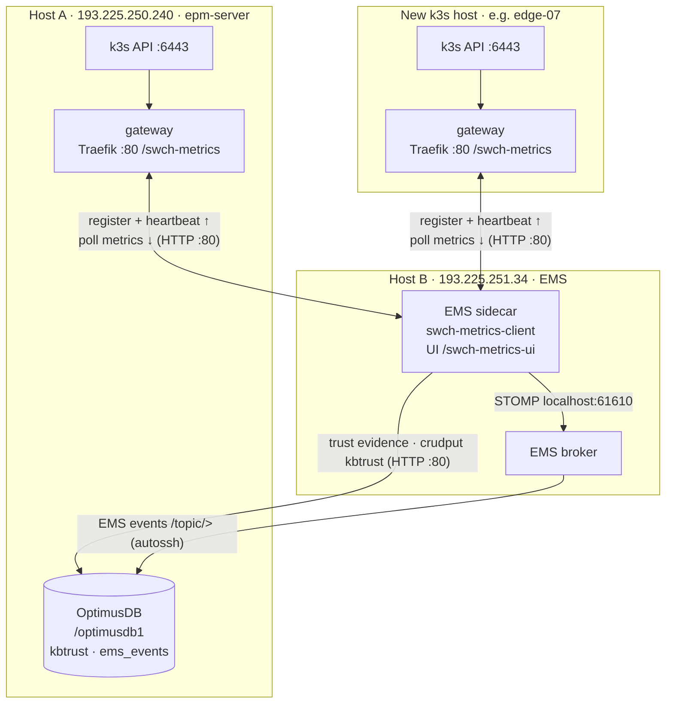
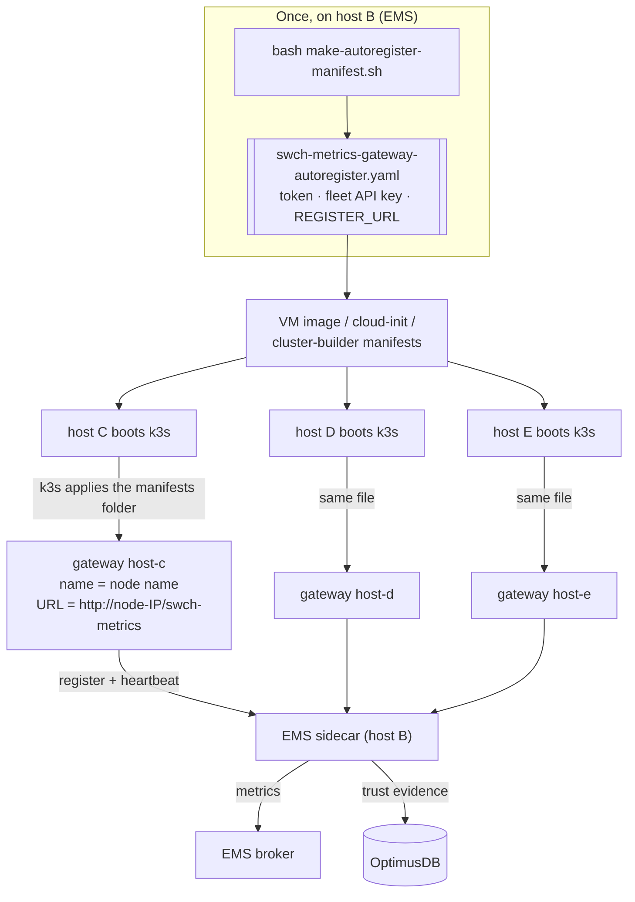
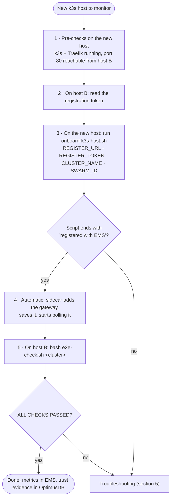
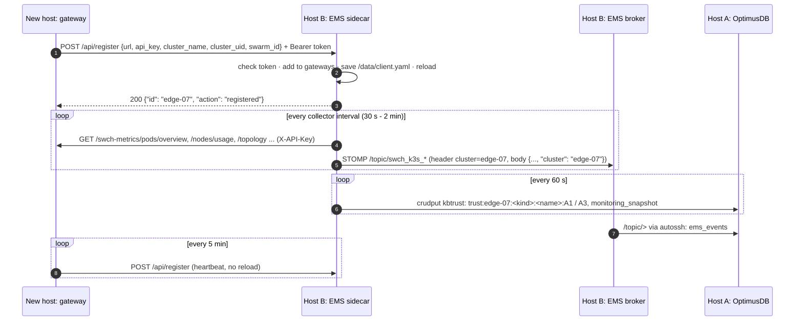
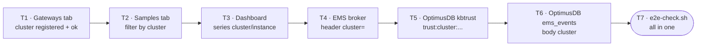

# Adding a k3s host to Swarmchestrate monitoring

Every k3s cluster runs one **k3s Metrics Gateway**. The **EMS sidecar** on the EMS host polls all gateways,
publishes the metrics to the **EMS broker**, and writes trust evidence to **OptimusDB**. A new k3s host
**registers itself** with the EMS sidecar. There are two ways to add one:

| Way | Per new host | When |
|-----|--------------|------|
| **A · Zero-touch** ([section 1](#1-zero-touch-every-new-host-joins-by-itself)) | nothing: one shared manifest file in the k3s manifests folder (VM image, cloud-init, cluster-builder) | hosts C, D, E … created by automation |
| **B · One command** ([section 2](#2-one-command-onboarding)) | `onboard-k3s-host.sh` with a chosen name / URL | an existing k3s host, or a custom name / URL |

| Host | Role | Address |
|------|------|---------|
| **Host B** | EMS + EMS sidecar (`swch-metrics-client`), UI `/swch-metrics-ui` | `193.225.251.34` |
| **Host A** | k3s + OptimusDB + gateway `/swch-metrics` | `193.225.250.240` (`epm-server`) |
| **New host** | k3s + gateway `/swch-metrics` | any host reachable from host B on port 80 |



All traffic is plain HTTP on **port 80** through the k3s Traefik ingress (plus SSH :22 for the existing autossh
tunnel). No other port has to be opened.

### Files in this repository

| File | Runs on | Used in |
|------|---------|---------|
| [`deploy/hosts/hostB/`](../deploy/hosts/) `upgrade-hostB.sh`, `hostB-ems-sidecar-patch.yaml`, `check-trust.sh` | host B (EMS) | section 0 |
| [`deploy/hosts/hostA/upgrade-hostA.sh`](../deploy/hosts/hostA/upgrade-hostA.sh) | host A | section 0 |
| [`deploy/onboard/make-autoregister-manifest.sh`](../deploy/onboard/make-autoregister-manifest.sh) | host B, once | section 1 (zero-touch) |
| [`deploy/onboard/cloud-init-k3s-swch.yaml`](../deploy/onboard/cloud-init-k3s-swch.yaml) | new VM (user-data) | section 1 |
| [`deploy/onboard/onboard-k3s-host.sh`](../deploy/onboard/onboard-k3s-host.sh) | new host | section 2 (one command) |
| [`deploy/onboard/e2e-check.sh`](../deploy/onboard/e2e-check.sh) | host B | sections 1–3 |
| [`deploy/k3s/swch-metrics-gateway-onboard.yaml`](../deploy/k3s/swch-metrics-gateway-onboard.yaml) | (used by the scripts) | sections 1–2 |

The `deploy/onboard` files are also attached to every GitHub release. Get them onto host B with:

```bash
cd /opt/iccs/Scripts/SetupK3sMetric
B=https://raw.githubusercontent.com/georgeGeorgakakos/k3s-metrics-gateway/main/deploy
for f in hosts/hostB/upgrade-hostB.sh hosts/hostB/hostB-ems-sidecar-patch.yaml hosts/hostB/check-trust.sh \
         onboard/e2e-check.sh onboard/make-autoregister-manifest.sh onboard/cloud-init-k3s-swch.yaml; do
  sudo curl -fsSL "$B/$f" -o "$(basename $f)"; done
sudo chmod +x *.sh
```

### Requirements for a new host

| # | Requirement | Check (on the new host unless stated) |
|---|-------------|---------------------------------------|
| 1 | Linux VM with **k3s** (single node or a cluster; the control-plane node runs the gateway) | `sudo k3s kubectl get nodes` → `Ready` |
| 2 | k3s **Traefik** ingress enabled (k3s default; not installed with `--disable traefik`) | `sudo k3s kubectl get crd ingressroutes.traefik.io` |
| 3 | **Inbound** TCP 80 from host B (193.225.251.34) | on host B: `curl -I http://<new-ip>/` → any HTTP answer (404 before onboarding) |
| 4 | **Outbound** TCP 80 to host B | `curl -s -o /dev/null -w '%{http_code}' http://193.225.251.34/swch-metrics-ui/api/register` → `405` |
| 5 | Outbound HTTPS to `ghcr.io` to pull the image (air-gapped: import it, see below) | `sudo k3s crictl pull ghcr.io/georgegeorgakakos/k3s-metrics-gateway:0.3.1` |
| 6 | **Unique cluster name**: the hostname (zero-touch) or `CLUSTER_NAME` (one command), lowercase | `hostname` |
| 7 | The IP that host B uses to reach the host is a node IP, or is given with `--node-external-ip` / `PUBLIC_HOST` | `hostname -I`; `sudo k3s kubectl get node -o wide` |
| 8 | ~100 MiB RAM, 0.05 CPU for the gateway | — |

Air-gapped host: on a machine with internet `docker pull ghcr.io/georgegeorgakakos/k3s-metrics-gateway:0.3.1 &&
docker save ghcr.io/georgegeorgakakos/k3s-metrics-gateway:0.3.1 -o gw.tar`, copy `gw.tar`, then
`sudo k3s ctr images import gw.tar`.

---

## 0. One-time setup (existing hosts)

Done once. Scripts: [`deploy/hosts/`](../deploy/hosts/) (download commands above). They read the API key, UI
password and token from the files and Secrets that stay on the hosts.

| # | Where | Command | Result |
|---|-------|---------|--------|
| 0.1 | GitHub | push `main`, then `git tag v0.3.1 && git push origin v0.3.1` | Release builds `ghcr.io/georgegeorgakakos/k3s-metrics-gateway:0.3.1` |
| 0.2 | Host B | `TRUST_NS=optimusddc bash upgrade-hostB.sh` | sidecar v0.3.1, registration open, prints **REGISTRATION TOKEN** |
| 0.3 | Host A | `bash upgrade-hostA.sh <token>` | host A registers itself as `epm-server` |
| 0.4 | Host B | `bash e2e-check.sh epm-server` | `RESULT: ALL CHECKS PASSED ✓` |
| 0.5 | Host B | `bash make-autoregister-manifest.sh` | `swch-metrics-gateway-autoregister.yaml` for zero-touch hosts (section 1) |

Run them in `/opt/iccs/Scripts/SetupK3sMetric` on each host.

---

## 1. Zero-touch: every new host joins by itself



| Step | Where | Command |
|------|-------|---------|
| 1 | host B, once | `bash make-autoregister-manifest.sh` → `swch-metrics-gateway-autoregister.yaml` (mode 600: holds the token) |
| 2a | existing k3s host | copy the file (`scp`), then `sudo install -m 600 swch-metrics-gateway-autoregister.yaml /var/lib/rancher/k3s/server/manifests/` |
| 2b | new VM | user-data from [`deploy/onboard/cloud-init-k3s-swch.yaml`](../deploy/onboard/cloud-init-k3s-swch.yaml) (paste `base64 -w0` of the file) |
| 2c | cluster-builder | add the file to the manifests it deploys |
| 3 | host B | `bash e2e-check.sh <node-name>` (or the Gateways tab) |

The same file works on every host. Each gateway works out:

| Value | Default | Override (ConfigMap `swch-cluster-identity` or k3s flag) |
|-------|---------|-----------------------------------------------------------|
| cluster name | name of the first control-plane node (the VM hostname) | `CLUSTER_NAME` (or set the hostname, e.g. `hostname:` in cloud-init) |
| URL for EMS | `http://<ExternalIP or InternalIP of that node>/swch-metrics` | `PUBLIC_HOST=<ip[:port]>`, `PUBLIC_URL=…`, or install k3s with `--node-external-ip <ip>` |
| API key | the shared fleet key in the file | per-host `API_KEY` in the Secret |

Names that clash get a suffix (`edge-07-2`). A host that is re-installed keeps its entry when its URL is the same.
If the EMS host reaches the VM through a floating / NAT IP, advertise it with `--node-external-ip`.

Check on the new host (about a minute after k3s has applied the file):

```bash
sudo k3s kubectl -n swarm-system get pods                                     # swch-metrics-gateway-… Running
sudo k3s kubectl -n swarm-system logs deploy/swch-metrics-gateway | grep -i regist   # registered with … as '<name>'
KEY=$(sudo k3s kubectl -n swarm-system get secret swch-metrics-gateway-auth -o jsonpath='{.data.API_KEY}' | base64 -d)
curl -s -H "X-API-Key: $KEY" http://localhost/swch-metrics/registration | python3 -m json.tool | head -20
```

---

## 2. One-command onboarding



### Step 1 · Pre-checks (on the new host)

```bash
sudo k3s kubectl get nodes                                   # node(s) Ready
sudo k3s kubectl get crd ingressroutes.traefik.io            # Traefik CRDs present
sudo k3s kubectl -n kube-system get svc traefik              # Traefik service on :80
curl -s -o /dev/null -w '%{http_code}\n' http://193.225.251.34/swch-metrics-ui/api/register   # 405 = reachable
hostname -I | awk '{print $1}'                               # IP that host B will use (PUBLIC_URL)
```

Pick a **unique cluster name** (lowercase, e.g. `edge-07`). It is used in EMS headers and OptimusDB `_id`s.

### Step 2 · Read the registration token (on host B)

```bash
sudo k3s kubectl -n default get secret swch-metrics-gateway-auth -o jsonpath='{.data.REGISTRATION_TOKEN}' | base64 -d; echo
```

### Step 3 · Onboard (on the new host)

```bash
curl -fsSL https://raw.githubusercontent.com/georgeGeorgakakos/k3s-metrics-gateway/v0.3.1/deploy/onboard/onboard-k3s-host.sh -o onboard-k3s-host.sh
sudo REGISTER_URL=http://193.225.251.34/swch-metrics-ui/api/register \
     REGISTER_TOKEN=<token from step 2> \
     CLUSTER_NAME=edge-07 SWARM_ID=swarm-01 \
     bash onboard-k3s-host.sh
```

Optional: `PUBLIC_URL=http://<ip>/swch-metrics` (when the first IP is not the one host B reaches),
`API_KEY=<key>` (default: generated), `CLOUD=`, `REGION=`, `ZONE=`.

Expected output:

```
== 1/6 pre-checks            ✓ k3s reachable  ✓ Traefik CRDs present  ✓ EMS sidecar reachable (HTTP 405)
== 2/6 identity              ✓ cluster edge-07, gateway URL http://<ip>/swch-metrics
== 3/6 gateway manifest      ✓ applied (gateway, RBAC, Traefik route /swch-metrics)
== 4/6 (re)start             ✓ gateway running
== 5/6 local check           ✓ http://localhost/swch-metrics answers (topology 200)
== 6/6 registration with EMS ✓ registered with EMS: "action":"registered" as "id":"edge-07"
```

### Step 4 · What happens automatically



Nothing has to be done on host A or host B.

---

## 3. End-to-end test (UI → EMS → OptimusDB)



UI: **http://193.225.251.34/swch-metrics-ui/** (user `admin`, password = `UI_PASSWORD` in `hostB-ems.yaml`).

| Test | Where | What to do | Expected |
|------|-------|------------|----------|
| **T1** | UI → **Gateways** | find the new cluster; press **Test** | row `edge-07`, source **registered**, status **ok**, heartbeat < 5 min; toast *reachable · cluster edge-07 · N nodes* |
| **T2** | UI → **Samples** | select the cluster in *All clusters* | rows with **Cluster** `edge-07` (node, pod, apiserver metrics) |
| **T3** | UI → **Dashboard** | choose `swch_k3s_node_cpu_pct` | legend shows `edge-07/<node>` next to `epm-server/<node>` |
| **T4** | host B shell | broker listen (below) | messages with `cluster = edge-07`, body ends with `"cluster": "edge-07"` |
| **T5** | any shell | OptimusDB `kbtrust` query (below) | `trust:edge-07:…:A1` / `:A3` documents, `updated_at` < 2 min ago |
| **T6** | any shell | OptimusDB `ems_events` (below) | recent events whose payload contains `"cluster": "edge-07"` |
| **T7** | host B shell | `bash e2e-check.sh edge-07` | `RESULT: ALL CHECKS PASSED ✓` |

**T4 · EMS broker (host B)**

```bash
sudo k3s kubectl -n default exec deploy/emsserver-ems-server -c swch-metrics-client -- python3 -c "
import stomp,time
class L(stomp.ConnectionListener):
    def on_message(s,f):
        if f.headers.get('cluster')=='edge-07': print(f.headers['destination'],'|',f.body)
c=stomp.Connection([('localhost',61610)]);c.set_listener('',L());c.connect('aaa','111',wait=True)
c.subscribe('/topic/>',id=1);time.sleep(30)"
```

**T5 · OptimusDB trust evidence (any host that reaches host A on port 80)**

```bash
ODB=http://193.225.250.240/optimusdb1/swarmkb/command
# all trust evidence of the cluster
curl -s -X POST $ODB -H 'Content-Type: application/json' \
  -d '{"method":{"cmd":"crudget","argcnt":1},"dstype":"kbtrust","criteria":[{"type":"trust_evidence","cluster":"edge-07"}]}' \
  | python3 -c "import sys,json;[print(d['_id'],d['value'],d['slo_met'],d['updated_at']) for d in json.load(sys.stdin)['data']]"
# only availability of the nodes
curl -s -X POST $ODB -H 'Content-Type: application/json' \
  -d '{"method":{"cmd":"crudget","argcnt":1},"dstype":"kbtrust","criteria":[{"type":"trust_evidence","cluster":"edge-07","attribute_id":"A1","subject_kind":"node"}]}' | python3 -m json.tool
# SLO violations across all clusters
curl -s -X POST $ODB -H 'Content-Type: application/json' \
  -d '{"method":{"cmd":"crudget","argcnt":1},"dstype":"kbtrust","criteria":[{"type":"trust_evidence","slo_met":false}]}' \
  | python3 -c "import sys,json;[print(d['_id']) for d in json.load(sys.stdin)['data']]"
```

Record names: `trust:<cluster>:<pod|node|control-plane>:<namespace>/<name>:<A1|A3>`; hourly copies end with
`:<YYYYMMDDTHH>` (`type: trust_evidence_history`); per-subject snapshot `monitoring:<cluster>:…`
(`type: monitoring_snapshot`).

**T6 · OptimusDB EMS events**

```bash
curl -s "http://193.225.250.240/optimusdb1/swarmkb/ems/events?limit=200&since_min=10" | grep -o 'edge-07' | wc -l
```

**T7 · Everything in one command (host B)**

```bash
cd /opt/iccs/Scripts/SetupK3sMetric
bash e2e-check.sh edge-07          # one cluster
bash e2e-check.sh                  # every registered cluster
```

```
== 1. EMS sidecar                ✓ v0.3.1  ✓ registration open  ✓ cluster known
== 2. gateway edge-07            ✓ enabled  ✓ registered  ✓ heartbeat  ✓ reachable + key  ✓ polled
== 3. samples from edge-07       ✓ 208 samples, 16 metrics (cluster, cluster_uid, swarm_id, gateway labels)
== 4. EMS broker                 ✓ 41 messages with header cluster=edge-07  ✓ cluster in body
== 5. OptimusDB                  ✓ 12 A1 + 12 A3  ✓ updated < 5 min  ✓ monitoring_snapshot  ✓ history  ✓ ems_events
RESULT: ALL CHECKS PASSED ✓
```

---

## 4. Disable or remove a host

| Goal | How |
|------|-----|
| Pause polling | UI → Gateways → switch off (stays registered) |
| Remove permanently | on the host: `sudo k3s kubectl -n swarm-system delete deploy swch-metrics-gateway` (stops the heartbeat), then UI → Gateways → **Delete** |
| Re-add | run `onboard-k3s-host.sh` again: same cluster UID → same entry |

Documents already in OptimusDB stay there (history).

## 5. Troubleshooting

| Symptom | Check | Fix |
|---------|-------|-----|
| onboarding: `cannot reach …/api/register` | `curl -I http://193.225.251.34/swch-metrics-ui/` from the new host | open the path from the new host to host B port 80 |
| onboarding: `HTTP 401 invalid registration token` | token from step 2 | copy the token again (no spaces / newline) |
| onboarding: `HTTP 403 registration is disabled` | host B `REGISTRATION_TOKEN` | run `upgrade-hostB.sh` |
| zero-touch host never appears | on the host: `sudo k3s kubectl -n swarm-system logs deploy/swch-metrics-gateway \| grep -i regist` | `no public URL` → set `PUBLIC_HOST`; `HTTP 401` → rebuild the manifest (token changed); file not applied → check `/var/lib/rancher/k3s/server/manifests/` |
| zero-touch host shows **error** in the Gateways tab | from host B: `curl -I <url shown>/health` | the node IP is private: install k3s with `--node-external-ip` or set `PUBLIC_HOST` |
| T1 status **error** `…/health unreachable` | from host B: `curl -I http://<new-ip>/swch-metrics/health` | wrong `PUBLIC_URL` (private IP?) → onboard again with `PUBLIC_URL=http://<ip host B reaches>/swch-metrics` |
| T1 **Test** says `HTTP 401` | API key mismatch | onboard again (the key is re-sent on registration) |
| T1 **stale** | `curl -s -H "X-API-Key: <key>" http://localhost/swch-metrics/registration` on the new host | gateway down or host B unreachable; check `kubectl -n swarm-system logs deploy/swch-metrics-gateway` |
| T5 no documents | UI → Sinks → `optimusdb-trust` error | trust sink disabled or OptimusDB unreachable from host B (`curl -I http://193.225.250.240/optimusdb1/`) |
| T6 no `cluster` in events | EMS sink option `body_labels` | must contain `cluster` (default) |

See also [multi-cluster.md](multi-cluster.md) (design, configuration, API) and
[trust-optimusdb.md](trust-optimusdb.md) (trust document schema), [query-kbtrust.md](query-kbtrust.md) (every `kbtrust` query).
