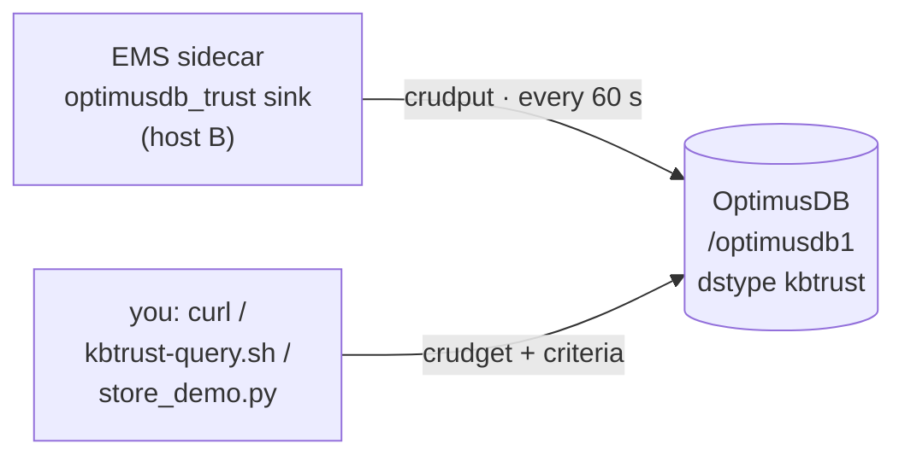

# Reading trust records from OptimusDB (`kbtrust`)

The EMS sidecar (`optimusdb_trust` sink) upserts trust evidence into OptimusDB under the
`kbtrust` data store. This page explains how to read it back: the raw API, ready-made `curl`
queries, and the helper script [`deploy/onboard/kbtrust-query.sh`](../deploy/onboard/kbtrust-query.sh).

- How the records are produced and the full document schema: [trust-optimusdb.md](trust-optimusdb.md)
- Checking a newly added host end to end: [add-k3s-host.md](add-k3s-host.md) (test T5)



## 1. The API

| | |
|---|---|
| Endpoint | `POST http://193.225.250.240/optimusdb1/swarmkb/command` (host A, Traefik port 80) |
| Header | `Content-Type: application/json` |
| Body | `{"method":{"cmd":"crudget","argcnt":1},"dstype":"kbtrust","criteria":[{ <filters> }]}` |
| Answer | `{"status":200, "data":[ <documents> ]}` |

`criteria` holds one object. Its fields are matched exactly against the top-level fields of the
documents and combined with **AND**. Nested fields (such as `subject.kind` or `evidence.*`) cannot be
filtered on, which is why the sink copies the subject fields to the top level.

## 2. What is stored

| `type` | One document per | `_id` | Updated |
|---|---|---|---|
| `trust_evidence` | subject × attribute (latest value) | `trust:<cluster>:<kind>:<ns>/<name>:<A1\|A3>` | every flush (60 s), overwritten |
| `trust_evidence_history` | subject × attribute × hour | `trust:…:<A1\|A3>:<YYYYMMDD>T<HH>`, plus `latest_id` | once per hour, kept |
| `monitoring_snapshot` | subject (uptime, restarts, A1/A3 scores together) | `monitoring:<cluster>:<kind>:<ns>/<name>` | every flush, overwritten |

Fields you can filter on:

| Field | Values | Example |
|---|---|---|
| `type` | `trust_evidence`, `trust_evidence_history`, `monitoring_snapshot` | `"type":"trust_evidence"` |
| `attribute_id` | `A1` (Availability), `A3` (Operational stability) | `"attribute_id":"A3"` |
| `cluster` | registered cluster name (host A = `epm-server`) | `"cluster":"epm-server"` |
| `cluster_uid`, `swarm_id` | cluster UID / swarm the cluster belongs to | `"swarm_id":"swarm-01"` |
| `subject_kind` | `pod`, `node`, `control-plane` | `"subject_kind":"node"` |
| `subject_name` | pod / node name | `"subject_name":"epm-server"` |
| `namespace` | e.g. `optimusddc` (empty for nodes and the control plane) | `"namespace":"optimusddc"` |
| `node`, `workload` | node the pod runs on, owning Deployment/StatefulSet | `"workload":"optimusdb1"` |
| `slo_met` | `true` / `false` (JSON boolean, not a string) | `"slo_met":false` |
| `_id` | exact document id | `"_id":"trust:epm-server:node:/epm-server:A1"` |

How to read a document:

| Field | A1 Availability | A3 Operational stability |
|---|---|---|
| `value` | available checks ÷ observed checks, 30 days | unplanned restarts / not-ready transitions, 7 days |
| `slo` | `>= 0.995` | `<= 2` |
| `score` | = `value` | `max(0, 1 − value/3)` |
| `evidence` | `checks_ok`, `checks_total`, `coverage` | `unplanned_events`, `warning_events`, `restart_counter` |

## 3. Ready-made `curl` queries

Run them from any shell that reaches host A (host A, host B, your laptop). Set the base once:

```bash
ODB=http://193.225.250.240/optimusdb1
q() { curl -s -X POST "$ODB/swarmkb/command" -H 'Content-Type: application/json' \
        -d "{\"method\":{\"cmd\":\"crudget\",\"argcnt\":1},\"dstype\":\"kbtrust\",\"criteria\":[$1]}" | python3 -m json.tool; }
```

| What | Command |
|---|---|
| Latest A1 + A3, all clusters | `q '{"type":"trust_evidence"}'` |
| Only A1 | `q '{"type":"trust_evidence","attribute_id":"A1"}'` |
| One cluster | `q '{"type":"trust_evidence","cluster":"epm-server"}'` |
| A3 of the pods in one cluster | `q '{"type":"trust_evidence","cluster":"epm-server","attribute_id":"A3","subject_kind":"pod"}'` |
| Nodes only | `q '{"type":"trust_evidence","subject_kind":"node"}'` |
| Control plane | `q '{"type":"trust_evidence","subject_kind":"control-plane"}'` |
| One workload | `q '{"type":"trust_evidence","workload":"optimusdb1"}'` |
| SLO violations | `q '{"type":"trust_evidence","slo_met":false}'` |
| One document | `q '{"_id":"trust:epm-server:node:/epm-server:A1"}'` |
| Hourly history of one cluster | `q '{"type":"trust_evidence_history","cluster":"epm-server","attribute_id":"A1"}'` |
| Monitoring snapshots | `q '{"type":"monitoring_snapshot","cluster":"epm-server"}'` |

Without the helper function, the full form is:

```bash
curl -s -X POST http://193.225.250.240/optimusdb1/swarmkb/command -H 'Content-Type: application/json' \
  -d '{"method":{"cmd":"crudget","argcnt":1},"dstype":"kbtrust","criteria":[{"type":"trust_evidence","attribute_id":"A3"}]}' \
  | python3 -m json.tool
```

Count only: append `| python3 -c "import sys,json;print(len(json.load(sys.stdin)['data'] or []))"` to the
`curl` instead of `python3 -m json.tool`.

## 4. Helper script: `kbtrust-query.sh`

Same queries with `key=value` filters, printed as a table (default), JSON or a count. Only `python3` is
needed.

```bash
R=https://raw.githubusercontent.com/georgeGeorgakakos/k3s-metrics-gateway/main/deploy/onboard
curl -fsSLO $R/kbtrust-query.sh && chmod +x kbtrust-query.sh

./kbtrust-query.sh                                         # latest A1/A3, every cluster
./kbtrust-query.sh cluster=epm-server                      # one cluster
./kbtrust-query.sh cluster=epm-server attribute_id=A3 subject_kind=pod
./kbtrust-query.sh slo_met=false                           # SLO violations
./kbtrust-query.sh type=trust_evidence_history cluster=epm-server --count
./kbtrust-query.sh type=monitoring_snapshot --json         # raw documents
./kbtrust-query.sh _id=trust:epm-server:node:/epm-server:A1 --json
ODB=http://<other-host>/optimusdb1 ./kbtrust-query.sh      # another OptimusDB
```

Without `type=` (or `_id=`), the script uses `type=trust_evidence`. `true`/`false` and numbers are sent as
JSON values, so `slo_met=false` works as expected. Example output:

```text
# 18 documents  criteria={"type": "trust_evidence"}
TYPE                   ATTR CLUSTER         KIND          SUBJECT                                            VALUE  SCORE  SLO  UPDATED
trust_evidence         A1   epm-server      control-plane epm-server                                     100.0000%  1.000  ok   2026-11-21T20:14:00Z
trust_evidence         A1   epm-server      node          epm-server                                      99.9100%  0.999  ok   2026-11-21T20:14:00Z
trust_evidence         A3   epm-server      pod           optimusddc/optimusdb1-6d9f7c8b5-k2x7p                  1  0.667  ok   2026-11-21T20:14:00Z
```

## 5. Other ways

| Tool | Command |
|---|---|
| Sidecar view, before OptimusDB (host B) | `curl -s -u admin:$PW http://193.225.251.34/swch-metrics-ui/api/trust` (`?attribute=A3`, `?kind=pod`, `?violations=true`) |
| Sidecar vs OptimusDB side by side (host B) | `bash deploy/hosts/hostB/check-trust.sh [A1\|A3] [pod\|node\|control-plane]` |
| optimusTrust `store_demo.py` | `python3 store_demo.py retrieve --store kbtrust --where type:trust_evidence --where attribute_id:A1` |
| | `python3 store_demo.py retrieve --store kbtrust --raw '{"_id":"trust:epm-server:node:/epm-server:A1"}'` (`--where` splits on `:`, so use `--raw` for `_id`) |

## 6. Troubleshooting

| Symptom | Cause / fix |
|---|---|
| `data` empty for `cluster=epm-server` | Records written before the cluster was registered carry the fallback name `swarm-01`: query without `cluster`, or with `"cluster":"swarm-01"` |
| `data` empty for `slo_met` | Sent as a string (`"false"`): it must be the JSON boolean `false` |
| `data` empty for every query | The sink is not writing: `check-trust.sh` on host B shows `written`, `errors`, `last_error` |
| `updated_at` older than a few minutes | Sidecar down or OptimusDB unreachable from host B: `kubectl -n default logs deploy/emsserver-ems-server -c swch-metrics-client --tail=50` |
| Nothing filters on `subject.kind` | Nested fields cannot be matched: use the top-level `subject_kind` |
| Connection refused / timeout | Run from a host that reaches host A port 80; raise the wait with `TIMEOUT=90 ./kbtrust-query.sh …` |
