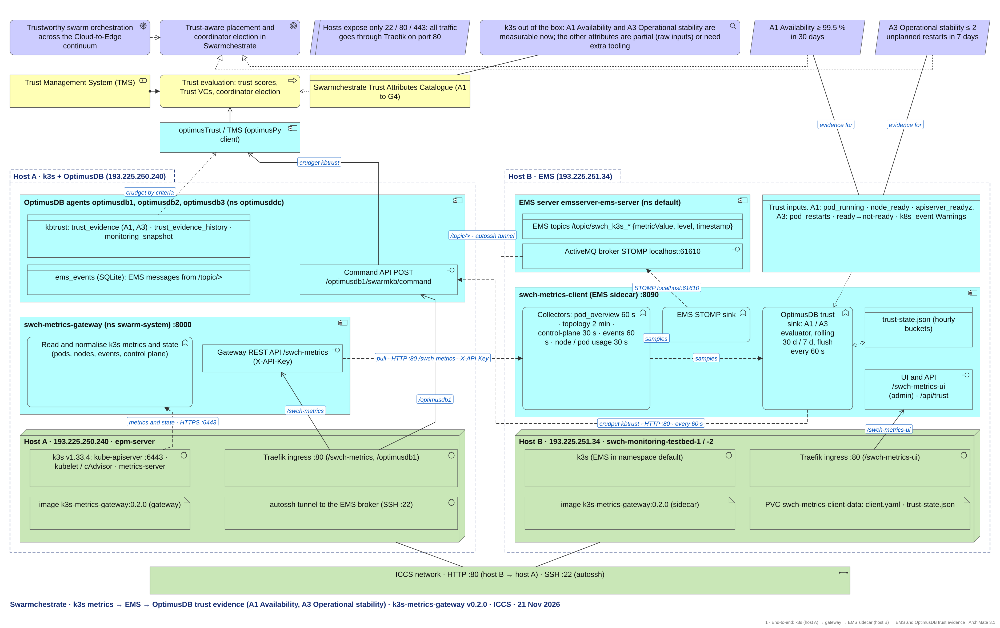
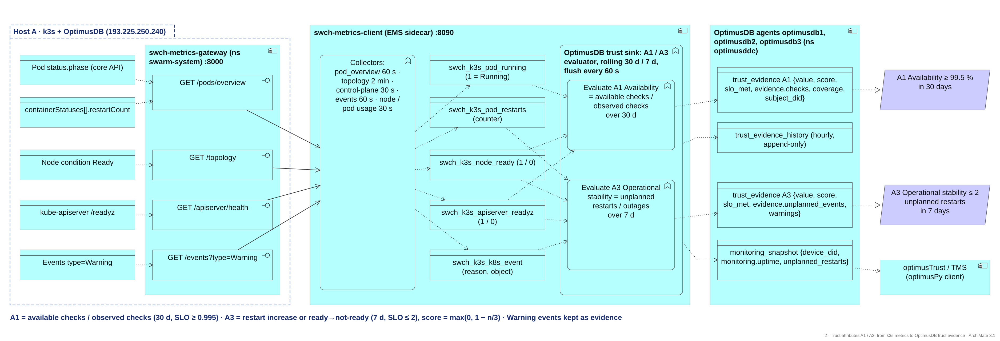

# Trust evidence in OptimusDB (`optimusdb_trust` sink)

The EMS sidecar (`swch-metrics-client`) already receives the k3s metrics of a
cluster from the gateway and publishes them to EMS. Starting with **v0.2.0** the
same sidecar can also turn those metrics into **trust-attribute evidence** and
persist it in **OptimusDB** (`dstype = kbtrust`), where the Trust Management
System (optimusTrust) can read it.

Only the attributes that k3s supports out of the box are produced. These are
the two marked *Yes* or *Partial* for runtime evidence in the Swarmchestrate
Trust Attributes Catalogue:

| ID | Attribute | Subject | Input metric (already collected) | Value | Catalogue SLO (default) |
|----|-----------|---------|----------------------------------|-------|--------------------------|
| **A1** | Availability | pod | `swch_k3s_pod_running` (Running phase per poll) | available checks / observed checks | ≥ 99.5 % over 30 d |
| | | node | `swch_k3s_node_ready` | 〃 | 〃 |
| | | control plane | `swch_k3s_apiserver_readyz` | 〃 | 〃 |
| **A3** | Operational stability | pod | `swch_k3s_pod_restarts` (container restart counter) | unplanned restarts in window | ≤ 2 in 7 d |
| | | node / control plane | ready → not-ready transitions | 〃 | 〃 |
| | evidence only | pod / node | `swch_k3s_k8s_event` Warnings: BackOff, OOMKilling, Unhealthy, Failed, Evicted, Rebooted, NodeNotReady | count | — |

The catalogue says not to count planned replacements as unplanned. A rollout
or reschedule creates a **new pod name**, so it starts a new subject and does
not count as a restart. Only restarts of containers inside the same pod count
towards A3. A1 for pods uses the *Running* phase as a proxy for readiness,
which matches the catalogue's "Partial".

## Data flow

```
Host A (193.225.250.240)                                     Host B (193.225.251.34)
k3s API :6443 ─▶ swch-metrics-gateway :8000 ─▶ Traefik :80 /swch-metrics ══ HTTP :80 ══▶ EMS pod
                                                                                         ├─ swch-metrics-client (sidecar)
                                                                                         │    ├─ ems sink ──STOMP localhost:61610──▶ ems-server
                                                                                         │    └─ optimusdb-trust sink (A1, A3)
OptimusDB agents optimusdb1..3  ◀── Traefik :80 /optimusdb1/swarmkb/command ◀══ HTTP :80 ═══┘   state: /data/trust-state.json (PVC)
   kbtrust datastore (CRDT-replicated)  ──▶ optimusTrust / TMS (store_demo.py retrieve)
```

Host B only makes **outbound** HTTP calls to host A on port 80. No new port is
opened on either host.

## What is written

Every `flush_interval` (60 s by default), one `crudput` per batch of 50 documents:

```http
POST http://193.225.250.240/optimusdb1/swarmkb/command
{"method": {"cmd": "crudput", "argcnt": 1}, "dstype": "kbtrust", "criteria": [ ...documents... ]}
```

| `type` | `_id` | Purpose |
|--------|-------|---------|
| `trust_evidence` | `trust:<cluster>:<kind>:<ns>/<name>:<A1\|A3>` | latest value, upserted every flush |
| `trust_evidence_history` | same + `:<YYYYMMDDTHH>` | hourly append-only copy (`history: true`) |
| `monitoring_snapshot` | `monitoring:<cluster>:<kind>:<ns>/<name>` | per-subject snapshot in the optimusTrust shape (`device_did`, `monitoring.uptime`) |

Example (`trust_evidence`, A3):

```json
{
  "_id": "trust:swarm-01:pod:optimusddc/optimusdb1-6d9f7c8b5-k2x7p:A3",
  "type": "trust_evidence", "attribute_id": "A3", "attribute": "Operational stability",
  "role_in_tms": "Calculable", "unit": "count/window",
  "subject": {"kind": "pod", "name": "optimusdb1-6d9f7c8b5-k2x7p", "namespace": "optimusddc", "node": "epm-server",
              "cluster": "swarm-01", "did": "did:swarm:swarm-01:pod:optimusddc:optimusdb1-6d9f7c8b5-k2x7p",
              "workload": "optimusdb1"},
  "subject_kind": "pod", "subject_name": "optimusdb1-6d9f7c8b5-k2x7p", "subject_did": "did:swarm:...",
  "cluster": "swarm-01", "namespace": "optimusddc", "node": "epm-server", "workload": "optimusdb1",
  "value": 1, "score": 0.6667,
  "slo": {"threshold": 2, "operator": "<=", "window": "7d",
          "catalogue_rule": "No more than 2 unplanned restarts in 7 days"},
  "slo_met": true,
  "evidence": {"unplanned_events": 1, "warning_events": 0, "recent_warning_reasons": [],
               "restart_counter": 1.0, "source_metric": "swch_k3s_pod_restarts",
               "method": "increase of container restart counter"},
  "window": {"start": "2026-11-20T09:00:00Z", "end": "2026-11-20T11:00:00Z", "seconds": 604800},
  "updated_at": "2026-11-20T11:00:00Z",
  "producer": {"client": "swch-metrics-client", "sink": "optimusdb-trust", "node_id": "…", "version": "0.2.0"}
}
```

Top-level copies of the subject fields (`subject_kind`, `subject_name`,
`subject_did`, `cluster`, `namespace`, `node`, `workload`) are included so the
documents can be filtered with plain OptimusDB criteria. No nested-field
matching is needed.

**Scores.** A1 `score` = availability ratio.
A3 `score` = `max(0, 1 − events / (max_unplanned_restarts + 1))`: 1.0 with no
events, 0 when the SLO is exceeded. This normalisation is illustrative. The TMS
can recompute its own score from `value` and `evidence`.

**Coverage.** `evidence.coverage` is the share of hours in the window that had
any check. The catalogue says missing checks must not be read as availability,
so a low coverage means the A1 value rests on little evidence.

## Configuration

```yaml
sinks:
  - id: optimusdb-trust
    type: optimusdb_trust
    enabled: true
    options:
      url: ${OPTIMUSDB_URL:-http://193.225.250.240/optimusdb1}
      context: swarmkb
      dstype: kbtrust
      cluster: ${TRUST_CLUSTER:-swarm-01}     # fallback only: since v0.3 each sample carries its cluster
      namespaces: [optimusddc]                # empty = every collected namespace
      flush_interval: 60s
      availability_window: 30d
      availability_slo: 0.995
      stability_window: 7d
      max_unplanned_restarts: 2
      did_map: {"epm-server": "did:swarm:capacity-vm-01"}   # optional: real DIDs
      history: true
      state_path: /data/trust-state.json
collectors:
  - id: pod-utilisation
    type: pod_overview
    metrics: [pod_cpu_pct_of_limit, pod_memory_pct_of_limit, pod_restarts, pod_running]   # pod_running is needed for A1
  - id: control-plane
    type: apiserver_health
    interval: 30s
```

All options can also be edited in the UI (**Sinks → optimusdb-trust → Edit**).
`dry_run: true` builds the documents without writing them, so you can inspect
them at `GET /api/trust`.

With `render_manifest.py` (new deployments): add
`--optimusdb-url http://<hostA>/optimusdb1 --trust-cluster <name> --trust-namespaces optimusddc`.

## Checking it

All the read queries (filters, `curl` one-liners, the `kbtrust-query.sh` helper) are in
[query-kbtrust.md](query-kbtrust.md). In short:

```bash
# what the sidecar computed (host B, through Traefik)
curl -s -u admin:$PW "http://193.225.251.34/swch-metrics-ui/api/trust" | python3 -m json.tool | head -60
curl -s -u admin:$PW "http://193.225.251.34/swch-metrics-ui/api/trust?violations=true"        # SLO breaches only
curl -s -u admin:$PW "http://193.225.251.34/swch-metrics-ui/api/status" | python3 -c \
  "import sys,json;print([s for s in json.load(sys.stdin)['sinks'] if s['type']=='optimusdb_trust'])"

# what OptimusDB holds (anywhere that can reach host A port 80)
curl -s -X POST http://193.225.250.240/optimusdb1/swarmkb/command -H 'Content-Type: application/json' \
  -d '{"method":{"cmd":"crudget","argcnt":1},"dstype":"kbtrust","criteria":[{"type":"trust_evidence","attribute_id":"A3"}]}' \
  | python3 -m json.tool

# with optimusTrust
python3 store_demo.py retrieve --store kbtrust --where type:trust_evidence --where attribute_id:A1
python3 store_demo.py retrieve --store kbtrust --where type:trust_evidence --where slo_met:false
python3 store_demo.py retrieve --store kbtrust --where type:monitoring_snapshot --where workload:optimusdb1
```

> `store_demo.py --where` splits on `:`, so use `--raw '{"_id": "trust:..."}'`
> to select by `_id`.

## Several clusters (v0.3)

With several gateways ([docs/multi-cluster.md](multi-cluster.md)) every subject is kept per cluster:
`trust:<cluster>:<kind>:<ns>/<name>:<A1|A3>`, with `cluster`, `cluster_uid` and `swarm_id` in each document. Two
clusters with a node of the same name produce separate documents. Query one cluster with
`{"type":"trust_evidence","cluster":"edge-07"}`.

## Limitations

- A1 for pods is based on the Running phase, not on container readiness or application health.
- A3 counts restarts only from the moment the sidecar first sees a pod. `evidence.restart_counter` carries the
  lifetime counter.
- The other catalogue attributes (A2, A4, B*, C*, …) are not produced: k3s does not expose the evidence for them
  without extra tooling (see the Excel columns *Out of the box* / *Command on host A*).

## Architecture (ArchiMate 3.1)

[`docs/archimate/Swarmchestrate_k3s-Trust-E2E.xml`](archimate/Swarmchestrate_k3s-Trust-E2E.xml) is an Open Group
Exchange Format model (60 elements, 109 relationships, 2 views). Import it in Archi with
*File → Import → Open Exchange XML Model*.




